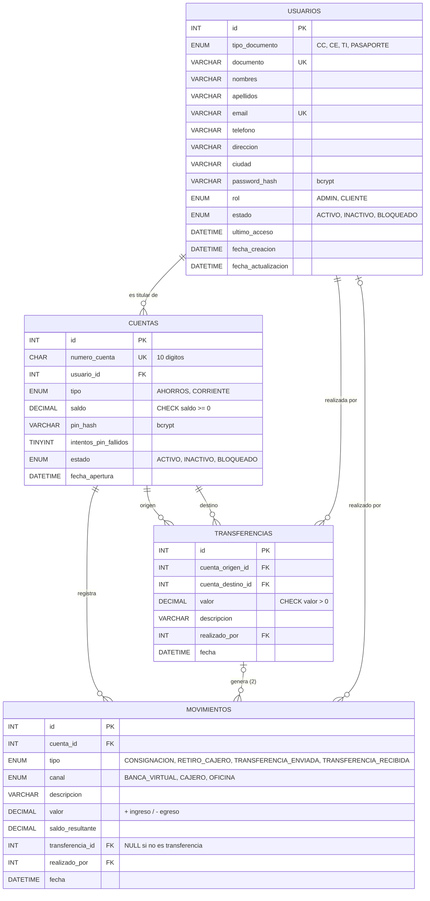

# Diagrama entidad–relación – Banco Horizonte

Imagen: [`diagrama-bd.png`](diagrama-bd.png). El siguiente diagrama Mermaid se visualiza directamente en GitHub y en VS Code (con la extensión *Markdown Preview Mermaid Support*).

## Restricciones y reglas implementadas en la base de datos

| Regla | Implementación |
|---|---|
| Documento y correo únicos | `UNIQUE (documento)`, `UNIQUE (email)` en `usuarios` |
| Número de cuenta único de 10 dígitos | `UNIQUE (numero_cuenta)` + `CHECK (numero_cuenta REGEXP '^[0-9]{10}$')` |
| El saldo nunca es negativo | `CHECK (saldo >= 0)` en `cuentas` |
| No hay operaciones con valores ≤ 0 | `CHECK (valor > 0)` en `transferencias`, `CHECK (valor <> 0)` en `movimientos` |
| No se transfiere a la misma cuenta | `CHECK (cuenta_origen_id <> cuenta_destino_id)` |
| No se eliminan clientes ni cuentas con historial | Llaves foráneas con `ON DELETE RESTRICT`; los clientes se manejan con `estado` |
| Los movimientos no se modifican ni eliminan | Triggers `trg_movimientos_no_update` y `trg_movimientos_no_delete` (igual para `transferencias`) |
| Contraseñas y PIN no se guardan en texto plano | Columnas `password_hash` y `pin_hash` con bcrypt |
